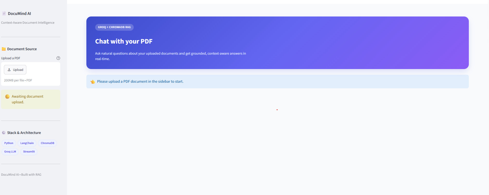
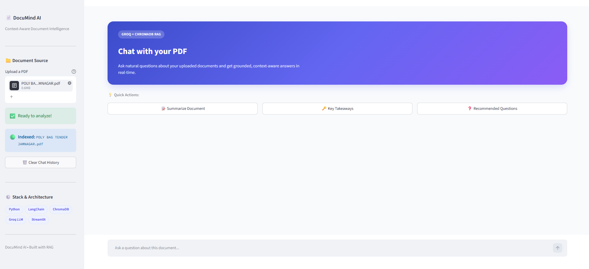
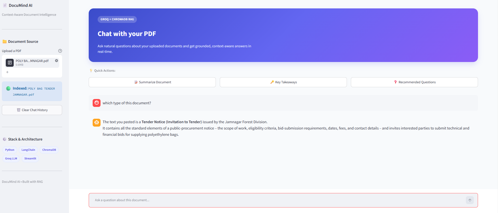
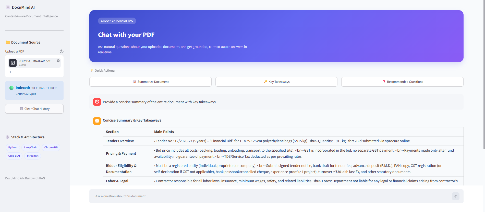

# 📄 DocuMind AI – Chat with Your PDF

<p align="center">
  <strong>AI-Powered PDF Question Answering System using Retrieval-Augmented Generation (RAG)</strong>
</p>

<p align="center">
  Python • Streamlit • LangChain • ChromaDB • Groq LLM
</p>

---

## 🚀 About the Project

**DocuMind AI** is an AI-powered PDF Question Answering application that allows users to interact with PDF documents using natural language.

Built using **Retrieval-Augmented Generation (RAG)**, the application retrieves relevant information from uploaded documents and generates context-aware answers using a Groq-powered Large Language Model (LLM).

Instead of manually searching through lengthy PDF files, users can simply upload a document and ask questions to get relevant answers.

## ✨ Features

-  **PDF Upload:** Upload PDF documents directly through the Streamlit interface.
-  **Document Processing:** Extract and process PDF content into manageable text chunks.
-  **Text Embeddings:** Convert document chunks into vector representations.
-  **Vector Storage:** Store embeddings in ChromaDB.
-  **AI-Powered Answers:** Generate context-aware responses using Groq LLM.
-  **Interactive Chat:** Ask multiple questions about uploaded documents.
-  **Document Summary:** Generate a concise summary of the entire document.
-  **Key Takeaways:** Extract the five most important points.
-  **Recommended Questions:** Generate useful questions based on document content.
-  **Clear Chat History:** Reset the current conversation.
-  **Duplicate Processing Prevention:** Use file hashing to avoid reprocessing the same PDF during a session.

## 📸 Project Screenshots

### 🏠 Application Dashboard



### 📄 PDF Upload and Processing



### 💬 AI Chat – Question & Answer



### 📝 Document Summary




## 🛠️ Tech Stack

| Technology | Purpose |
|---|---|
| Python | Core programming language |
| Streamlit | Interactive web application |
| LangChain | RAG workflow and LLM integration |
| ChromaDB | Vector database |
| Groq LLM | AI-powered response generation |
| Embedding Model | Text vectorization and semantic search |

## 🏗️ RAG Workflow

The application follows a Retrieval-Augmented Generation workflow:

1. **PDF Upload:** User uploads a PDF document.
2. **Text Extraction:** Extract text from the PDF.
3. **Text Chunking:** Split extracted text into smaller chunks.
4. **Embedding Generation:** Convert chunks into numerical vectors.
5. **Vector Storage:** Store embeddings in ChromaDB.
6. **User Query:** User asks a question about the document.
7. **Context Retrieval:** Retrieve relevant chunks using semantic similarity search.
8. **LLM Processing:** Send the retrieved context and question to Groq LLM.
9. **Answer Generation:** Generate and display a context-aware response.

## 📂 Project Structure

```text
PDF-QA-RAG-Bot/
│
├── images/
│   ├── app_home.png
│   ├── pdf_upload.png
│   ├── chat_response.png
│   ├── document_summary.png
│   
│
├── app.py
├── rag_utility.py
├── requirements.txt
├── .env.example
├── .gitignore
└── README.md
```

## ⚙️ Installation & Setup

### 1. Clone the Repository

```bash
git clone https://github.com/riddhibhuva25/PDF-QA-RAG-Bot.git
```

### 2. Navigate to the Project Directory

```bash
cd PDF-QA-RAG-Bot
```

### 3. Create a Virtual Environment

```bash
python -m venv .venv
```

### 4. Activate Virtual Environment

For Windows:

```bash
.venv\Scripts\activate
```

### 5. Install Dependencies

```bash
pip install -r requirements.txt
```

### 6. Configure Environment Variables

Create a `.env` file in the project root directory using `.env.example` as a reference.

Add your Groq API key using the variable name expected by `rag_utility.py`.

Example:

```env
GROQ_API_KEY=your_groq_api_key_here
```

**Note:** Never upload your actual `.env` file or expose API keys on GitHub.

### 7. Run the Application

```bash
streamlit run app.py
```

Open the local URL displayed in your terminal to access DocuMind AI.

## 💡 How to Use

1. Launch the application.
2. Upload a PDF document using the sidebar.
3. Wait until document indexing is completed.
4. Ask questions using the chat input.
5. Use quick actions to summarize the document, extract key takeaways, or generate recommended questions.
6. Continue interacting with your document through the chat interface.

## 🔐 Security

- Store API keys in a local `.env` file.
- Exclude `.env` from Git using `.gitignore`.
- Do not commit sensitive documents or credentials.
- Use `.env.example` to share the required environment variable names safely.

## 🎯 Project Objective

The objective of DocuMind AI is to simplify document analysis through Large Language Models, vector databases, and Retrieval-Augmented Generation.

This project demonstrates practical implementation of a RAG pipeline, document embeddings, semantic retrieval, vector storage, and LLM-based question answering.

## 👩‍💻 Author

**Riddhi Bhuva**

- GitHub: [@riddhibhuva25](https://github.com/riddhibhuva25)

---

⭐ If you find this project useful, don't forget to give it a star!
